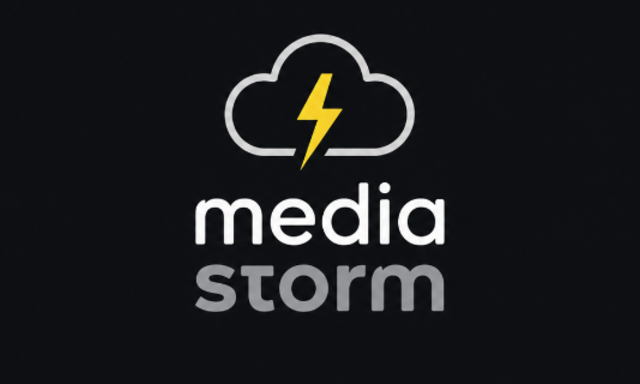

<p align="center">

</p>

# mediastorm

mediastorm is a self-hosted streaming platform for movies, television, and live TV. It combines Usenet, debrid services, personal media libraries, and IPTV sources behind native iOS, tvOS, Android, and Android TV apps, plus a browser-based web app.

Features include multi-profile watch history and recommendations, kids profiles, offline downloads, Live TV and DVR, subtitles, casting, Watch Together rooms, and encrypted Iroh connection invites for remote access.

[Releases](https://github.com/godver3/mediastorm/releases) · [Android Mobile](https://github.com/godver3/mediastorm/releases/download/android-latest/mediastorm-mobile.apk) · [Android TV](https://github.com/godver3/mediastorm/releases/download/android-latest/mediastorm-tv.apk) · [iOS TestFlight](https://testflight.apple.com/join/8vCQ5gmH) · [tvOS TestFlight](https://testflight.apple.com/join/X9bE3dq6) · [Native tvOS TestFlight](https://testflight.apple.com/join/6uMySrhk) · [Native Android TV](https://github.com/godver3/mediastorm/releases/download/androidtv-native-latest/mediastorm-androidtv.apk) · [Discord](https://discord.gg/kT74mwf4bu)

## Source layout

- `backend/`: Go server and supporting production services.
- `backend/iroh-host/`: Rust host for encrypted Iroh remote access.
- Native clients live in the separate [frontend repository](https://github.com/godver3-org/mediastorm-frontend); its `modules/iroh-bridge/` owns the production Rust/native client bridge.
- `archive/iroh-ios-bridge/`: historical iOS linking scaffold, retained for reference.

## Features

- **On-demand streaming:** Search multiple Usenet and torrent sources, rank releases, and stream through built-in Usenet or supported debrid providers.
- **Personal media libraries:** Browse and play local, Plex, and Jellyfin libraries alongside discovered content.
- **Live TV and DVR:** Use M3U playlists, HDHomeRun tuners, Xtream Codes, Stalker Portal, or Stremio sources with EPG data and scheduled recordings. HDHomeRun automatically downloads its channel lineup and guide (2 days free, or 14 days with a DVR guide subscription).
- **Profiles and activity:** Maintain per-profile watchlists, playback progress, history, calendars, custom lists, content preferences, and recommendations. Profiles can use PINs, kids restrictions, and source-level access controls.
- **Playback:** Native playback on mobile and TV, browser playback at `/watch`, offline downloads in the mobile apps, external subtitle search, and Google Cast or DLNA playback on supported clients.
- **Connected services:** Import lists and synchronize activity with services including Trakt, Simkl, MDBList, and Letterboxd.
- **Shared viewing:** Create Watch Together rooms for other profiles or invite external browser guests.
- **Remote access:** Connect apps through encrypted Iroh invitations without opening an inbound port. VPN access remains supported and is recommended when practical.

## Supported Integrations

| Area | Supported services and protocols |
| --- | --- |
| Debrid | Real-Debrid, TorBox, AllDebrid, Premiumize, Torrin |
| Usenet streaming | Built-in NNTP, SABnzbd-compatible engines, AltMount, NZBDav/NZBDavEx, Decypharr, InfiniDysk-compatible setups |
| Usenet indexers | Newznab, Prowlarr |
| Torrent and direct-stream sources | Torrentio, Prowlarr, Jackett, Zilean, AIOStreams, Nyaa, Comet, MediaFusion, Internet Archive |
| Media libraries | Local media, Plex, Jellyfin |
| Live TV | M3U, HDHomeRun with automatic guide, Xtream Codes, Stalker Portal, Stremio add-ons, XMLTV EPG |
| Lists and scrobbling | Trakt, Simkl, MDBList, Letterboxd |
| Subtitles | Embedded tracks, OpenSubtitles, SubDL |
| Metadata | TMDB, optional TVDB and MDBList enrichment |
| AI recommendations | Gemini, OpenAI, Anthropic, OpenRouter, NanoGPT, LinkAPI, Ollama |

Not every integration is required. A typical installation needs TMDB plus at least one content path, such as Usenet, debrid, a media library, or Live TV.

## Requirements

- A host that can run Docker Compose
- Persistent storage for PostgreSQL and the mediastorm cache directory
- A free TMDB API key for baseline movie and TV metadata
- At least one configured content source
- A mediastorm client or a modern browser for the web app

All clients require a running mediastorm backend.

## Quick Start

The repository's [`docker-compose.yml`](docker-compose.yml) is the canonical deployment example.

1. Download that file and create a `.env` file beside it:

```dotenv
POSTGRES_PASSWORD=replace-with-a-long-random-password
TZ=America/Edmonton

# Optional on Linux: run the container as the owner of the cache directory.
PUID=1000
PGID=1000
```

2. Edit the cache volume in `docker-compose.yml`:

```yaml
volumes:
  - /path/to/your/cache:/root/cache
```

If `PUID` and `PGID` are set, the selected user must already have read and write access to the cache folder. The image does not change ownership automatically. On Linux, you can prepare it with:

```bash
sudo chown -R "$(id -u):$(id -g)" /path/to/your/cache
```

3. Start the backend and PostgreSQL:

```bash
docker compose up -d
```

4. Open `http://localhost:7777/admin` and sign in with the initial credentials `admin` / `admin`. You must choose a replacement password before the first authenticated session is created.

5. Complete the first-run configuration:

   1. Add your TMDB API key under **Settings → Metadata**.
   2. Configure at least one content path: Usenet, debrid, a media library, or Live TV.
   3. Use the admin connection tests to verify the configured services.
   4. Sign into a native app or open `http://localhost:7777/watch`.

The backend health endpoint is available at `http://localhost:7777/health`.

> [!WARNING]
> Change both default passwords before relying on the server: the mediastorm `admin` password during first login and the PostgreSQL password in `.env`. Do not expose mediastorm directly to the public internet. Prefer a VPN or overlay network such as [Tailscale](https://tailscale.com/), or use mediastorm's Iroh connection invites.

> [!NOTE]
> mediastorm is developed with assistance from large language models. Best efforts are made to review security and code integrity, but the software is provided without warranty and should be used at your own risk.

### Data Storage and Upgrades

Application settings, cached metadata, stream metadata, recordings, and backup files are stored under the mounted cache directory. Accounts, profiles, watch history, playback progress, and other relational user data are stored in PostgreSQL.

When upgrading an older installation to PostgreSQL, mediastorm migrates supported JSON data on first startup. Original JSON files are preserved with a `.migrated` suffix in the cache directory.

Use **Admin → Backups** to create, download, restore, or schedule application backups. Also protect the PostgreSQL volume and cache directory as part of the host's normal backup strategy.

## Web and Native Clients

The server provides three browser entry points:

- `http://localhost:7777/admin` — server setup, connections, users, tasks, backups, and diagnostics
- `http://localhost:7777/account` — account management
- `http://localhost:7777/watch` — consumer web app and browser playback

### iOS and tvOS

Available on TestFlight:

- iOS: [Join TestFlight](https://testflight.apple.com/join/8vCQ5gmH)
- tvOS: [Join TestFlight](https://testflight.apple.com/join/X9bE3dq6)

Incremental updates are delivered automatically through OTA updates. Native changes require updating through TestFlight.

### Android and Android TV

- Android Mobile: [Download APK](https://github.com/godver3/mediastorm/releases/download/android-latest/mediastorm-mobile.apk) — Downloader code [`3364803`](https://aftv.news/3364803)
- Android TV: [Download APK](https://github.com/godver3/mediastorm/releases/download/android-latest/mediastorm-tv.apk) — Downloader code [`7856845`](https://aftv.news/7856845)
- [Versioned release history](https://github.com/godver3/mediastorm/releases)

Incremental updates are delivered automatically through OTA updates. Native changes require downloading the latest APK or entering the permanent Downloader code for the device.

### Native tvOS and Android TV (preview)

Fully native TV clients, built separately from the apps above: SwiftUI on tvOS and Compose for TV on Android TV. They install alongside the existing apps rather than replacing them.

- tvOS: [Join TestFlight](https://testflight.apple.com/join/6uMySrhk)
- Android TV: [Download APK](https://github.com/godver3/mediastorm/releases/download/androidtv-native-latest/mediastorm-androidtv.apk) — Downloader code [`6740631`](https://aftv.news/6740631)

The tvOS app updates through TestFlight. The Android TV app checks for new builds itself and offers to install them; the APK link and Downloader code always point at the latest build.

### Jellyfin Apps (Jellyfin Bridge)

mediastorm can also act as a Jellyfin server, so stock Jellyfin clients (jellyfin-web, Jellyfin for Android TV, Swiftfin, Findroid, Streamyfin, Infuse, ...) can browse and play. Turn it on under **Admin → Integrations → Jellyfin Bridge**, where its settings are too. It runs only while enabled, starts and stops without a mediastorm restart, and listens on its own port (default `8096`, published like `7777`).

- **Server address:** `http://<host>:8096`; the bridge can also serve the Jellyfin web client at `http://<host>:8096/web/`, which the Jellyfin Android app and Jellyfin Media Player need (they load the server's web interface; native apps such as Android TV, Swiftfin, Findroid or Plezy do not). mediastorm does not ship jellyfin-web, which is GPL-2.0 licensed: copy an unmodified build out of the official image, tested with Jellyfin 12.2 (`docker create --name jellyfin-web-src jellyfin/jellyfin:12`, `docker cp jellyfin-web-src:/jellyfin/jellyfin-web ./jellyfin-web`, `docker rm jellyfin-web-src`) and mount it read-only at `/app/jellyfin-web` (`- ./jellyfin-web:/app/jellyfin-web:ro`), or point **Web Client Directory** at another folder. The Integrations page shows whether a build was found. LAN clients can also find it through Jellyfin's UDP discovery on port 7359. Discovery needs host networking in Docker (broadcasts do not cross the bridge network); otherwise add the server by address.
- **Sign in:** every profile is a Jellyfin user, and the password is the owning account's password.
  - With **Security → Enforce Profile PINs** on, a PIN-locked profile signs in with the account password followed by the PIN (e.g. `secret1234`).
  - **Allow PIN Login** accepts the PIN alone. That is weaker, since a 4-digit PIN is easy to guess.
  - Profiles are named `account/profile` in Jellyfin apps (e.g. `household/Anna`), so names are unique across accounts. Type that name at the sign-in prompt; the profile name alone also works when the password identifies the account.
  - **Show Profile List** (off by default) lists the profiles on the sign-in screen. Since the names contain the account login, anyone who can reach the port then sees it; turn it on only on a LAN or behind a VPN with people you trust. Quick Connect works either way.
  - **Quick Connect**: a TV shows a code; approve it from a signed-in app (user menu → Quick Connect) instead of typing the password on the TV.
  - **Jellyfin devices** in the admin and account pages lists signed-in apps and signs them out.
  - Behind a reverse proxy in Docker, add the proxy's network to **Trusted Proxies** so login limits apply per client.
- **Libraries:** *My Movies* and *My Shows* (watchlist, custom lists and in-progress titles), *Trending Movies* and *Trending Shows*, *Lists*, *Live TV* (when the profile has a channel source), and every local or synced library the profile can access. Search finds anything in the metadata catalog. Kids profiles get the same restrictions as in the mediastorm apps.
- **Playback:** pressing play runs the same source resolution as the mediastorm apps.
  - Browsers get an HLS stream with a seekable full-length timeline, cut at the file's own keyframes. The video is passed through untouched whenever the player declares it can decode it: H.264 always; HEVC and AV1 for browsers that decode them (fMP4 segments) and TV browsers (MPEG-TS); HDR10, HDR10+ and HLG for players that report HDR support; Dolby Vision for players that report it (Safari), and profile 8 as its HDR10/HLG base layer elsewhere. Everything else, and files without a keyframe index, is converted to SDR H.264. **Pass Through HEVC/AV1**, **HDR** and **Dolby Vision** in the bridge settings turn each of these off.
  - Audio the player cannot decode (AC-3, E-AC-3, DTS, TrueHD) is converted to AAC; players that declare AC-3/E-AC-3 support keep the original track. If a passed-through stream fails to play, the next attempt on that device is converted.
  - **Disable Video Transcoding** never re-encodes video: it is always copied, even when the app does not report support (it may then play without picture or with wrong colours), streams that cannot be copied do not play, and Live TV is passed through as received. **Disable Audio Transcoding** keeps every audio track as it is; tracks the app cannot decode then play silently.
  - Native apps also get direct play with byte ranges, within their device profile.
  - **Choosing a release:** movies and episodes list mediastorm's top releases as versions (the version picker on the detail page; **Release Versions**, default 15, sets how many, and 0 turns the picker off), in mediastorm's ranking order and without releases the profile's filters reject. Versions are named from the release name: resolution, codec, HDR, source, audio, languages, group and size. The list is searched when the detail page first opens (the page waits up to 3 seconds for it), for a series' next episode when its page opens and for the following episode while one plays, and kept for 30 minutes.
  - *Auto* plays mediastorm's own pick. With **Auto: Avoid Video Transcoding** (on by default), when that pick's video would be transcoded for the app (a codec, HDR or Dolby Vision format it does not declare), Auto plays the best-ranked release the app takes as it is instead; up to 3 more releases are tried, then it falls back to the first pick. Apps that have not played anything yet declare their capabilities on the first playback, so the first Auto pick on a new device uses that playback's device profile.
  - Progress, watched state and favorites (the watchlist) sync back to mediastorm, and from there to Trakt and the other scrobblers.
  - The player's playback info shows whether a stream is played directly, remuxed, direct-streamed or transcoded, and why.
- **Extras:** skip prompts for intros, recaps and credits (from IntroDB, SkipDB and chapter names), *More like this* on detail pages, upcoming episodes of your shows from the release calendar, genre pages, and filmographies on person pages.
  - Scrubbing previews (trickplay) appear when **Playback → Thumbnails** is enabled; they are built from mediastorm's seek thumbnails, so they are coarser than Jellyfin's (one frame per 30–60 s).
  - Watched state, favorites and resume positions changed on one device refresh on the profile's other devices.
  - Chapters of the file (seek bar markers, next/previous chapter) appear once the stream is resolved: the detail page resolves it in the background, and a movie's page waits up to 3 seconds for it on first open. Chapter images are not provided.
- **Over the internet:** put an HTTPS reverse proxy in front of the bridge port (plain HTTP sends passwords and tokens in cleartext), set **Trusted Proxies** to the proxy and leave **Show Profile List** off. Keep the admin pages on port 7777 off the internet, or use a VPN instead.
- **Not supported:** admin dashboard, SyncPlay, remote control, recordings and DVR, studios, music, Android TV's external-player mode.

Bridge tokens only work on the bridge port; the main API, admin and account pages reject them.

## Connection Invites and Iroh Remote Access

mediastorm includes an Iroh-based connection invite system for remote app access without opening ports or configuring a reverse proxy. Create an invite in the admin panel, share its short code, and enter that code from the app's login screen. The person connecting still needs a valid mediastorm username and password, either for the primary account or a sub-account created for them.

The backend creates a full Iroh invite and a shorter, single-use connection code. It publishes a temporary DHT rendezvous record that lets the app use the short code to locate the full invite. The record is signed with a key derived from the short code, so the public DHT record does not directly identify the backend. The app then attempts a direct or hole-punched connection and can use an Iroh relay for initial reachability when necessary.

Traffic remains encrypted between the app and the backend even when a relay forwards it. After a successful connection, the short code is claimed and cannot be reused.

Remote performance depends on network conditions and may be slower than LAN playback, particularly for high-bitrate video. When connected through an Iroh bridge, use the built-in player; external players such as VLC or Infuse are not supported on that path.

## Configuration

Most configuration is available through the admin panel at `http://localhost:7777/admin`. Configure services there instead of editing `settings.json` directly.

### Metadata and Optional API Keys

| Service | Required | Purpose | Get a key |
| --- | --- | --- | --- |
| **TMDB** | Yes | Baseline movie and TV metadata, episodes, artwork, cast, and trailers | [TMDB API settings](https://www.themoviedb.org/settings/api) |
| **TVDB** | No | Alternate episode orders, precise broadcast times, and additional aliases, artwork, and trailers | [TVDB API information](https://thetvdb.com/api-information) |
| **MDBList** | No | Ratings from multiple sources and list/scrobbling integration | [MDBList preferences](https://mdblist.com/preferences/) |
| **AI provider** | No | Personalized recommendations based on watch history and watchlist | Configure a supported provider in the admin panel |

Without TVDB, TMDB continues to provide normal movie and TV metadata. Alternate episode ordering and exact broadcast times are unavailable, and titles or assets catalogued only by TVDB may be absent.

### AI Recommendations

AI-powered **Recommended For You** shelves are optional. Supported providers are Gemini, OpenAI, Anthropic, OpenRouter, NanoGPT, LinkAPI, and Ollama; the provider, model, API key, and compatible base URL are configurable under **Settings → Metadata**.

Without an AI provider, mediastorm still provides TMDB-based recommendations such as **Because You Watched**. AI recommendation results are cached per user. Availability, pricing, model names, and quotas are determined by the selected provider, so consult that provider's current documentation.

#### Self-hosted Ollama

In **Settings → Metadata**, select **Ollama**, enter an installed **AI Model** name (including its tag), and set **AI Base URL** to your Ollama server. Both `http://server:11434` and `http://server:11434/v1` are accepted. Leave **AI API Key** blank unless your own proxy requires a bearer token. Changing to or from Ollama clears the previous AI connection fields; enter and save the new connection details.

The default is `http://localhost:11434/v1`, suitable when the backend and Ollama run on the same host outside Docker. From a Docker backend, use a reachable Ollama service name or host address; `localhost` points to the backend container. For a separate server, configure Ollama to listen on a reachable private interface using `OLLAMA_HOST` and permit access from the backend. Keep the service on your private network/VPN.

Pull the model on the Ollama server before using **Test Connection**. That test verifies reachability and model availability; recommendation quality depends on the selected model. Cold model loads have a bounded three-minute inference budget. TMDB title resolution and other metadata services still require their normal configuration. MediaStorm does not download models or make the rest of the application offline.

See [Ollama setup](https://docs.ollama.com/faq) and [API compatibility](https://docs.ollama.com/api/openai-compatibility).

## Troubleshooting

- **Backend does not become healthy:** Run `docker compose ps`, then inspect `docker compose logs mediastorm` and `docker compose logs postgres`.
- **Permission errors:** Confirm the container user selected by `PUID`/`PGID` can write to the mounted cache directory.
- **Database errors:** Verify `POSTGRES_PASSWORD` is consistent between PostgreSQL and `DATABASE_URL`, then check that the PostgreSQL health check passes.
- **Search returns no playable results:** Add TMDB and configure a complete content path, then run the connection tests in the admin panel.
- **Forgotten account password:** Run `docker compose exec mediastorm ./mediastorm recover-account -master -generate` for the primary account, or replace `-master` with `-username <name>` for a sub-account.

For source development, runtime logs are written to `.logs/backend.log` and `.logs/frontend.log`. Backend runtime diagnostics are available from localhost under `/api/debug/runtime` and `/api/debug/pprof/`.

## Development

The root repository contains the Go backend, documentation, and deployment tooling. `frontend/` is a separate Git repository containing the Expo React Native application, so run and commit frontend work from that directory.

```bash
# Backend
cd backend
make run
make test
make check
make build

# Frontend
cd frontend
npm ci
npm run start
npm run start:tv
npm run test
npm run lint

# Full local stack, from the repository root
./dev.sh start
./dev.sh restart backend
./dev.sh stop
```

The main source layout is:

- `backend/handlers/` — HTTP and web handlers
- `backend/services/` — business logic and integrations
- `backend/internal/` — core infrastructure and datastore packages
- `frontend/app/` — Expo routes
- `frontend/components/` — shared React Native UI
- `frontend/services/` and `frontend/hooks/` — reusable client logic
- `frontend/modules/` — native platform modules

## Acknowledgments

Thanks to [nzbdav](https://github.com/nzbdav-dev/nzbdav) and [altmount](https://github.com/javi11/altmount) for paving the way with Usenet streaming.

Inspired by [plex_debrid](https://github.com/itsToggle/plex_debrid) and [Riven](https://github.com/rivenmedia/riven).

Special thanks to [Parsett (PTT)](https://github.com/dreulavelle/PTT) for media title parsing.

Powered by [FFmpeg](https://ffmpeg.org/) for media processing and [yt-dlp](https://github.com/yt-dlp/yt-dlp) for trailer fetching.

Native playback is powered by [KSPlayer](https://github.com/kingslay/KSPlayer) on iOS/tvOS, and [ExoPlayer](https://github.com/google/ExoPlayer) and [MPV](https://mpv.io/) on Android/Android TV.

## License

MIT
